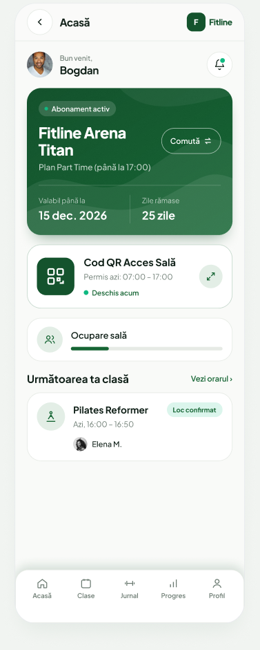
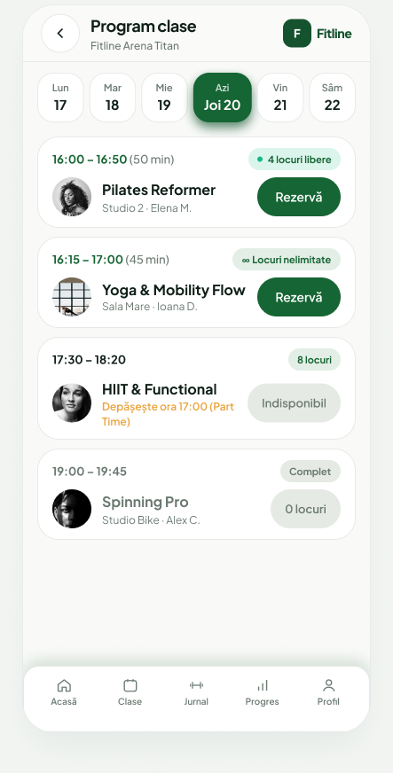
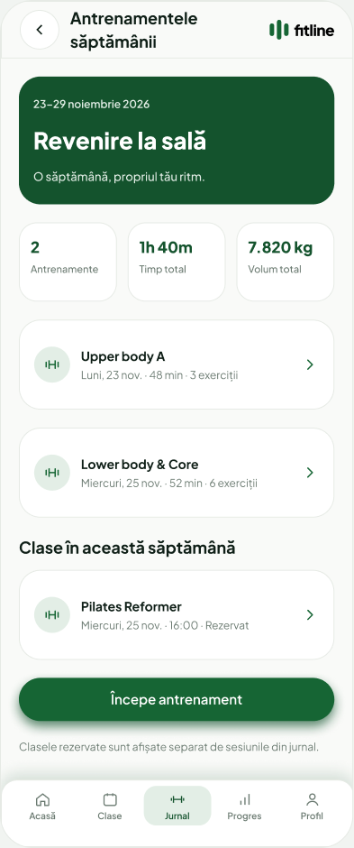

# Fitline

**A multi-gym fitness platform and personal workout journal, powered by a Laravel REST API.**

Fitline brings gym discovery, memberships, class schedules, and workout tracking into one mobile-first experience. Members can browse gyms and their plans, review their own memberships, check class times, and log their training week by week.

**Stack** · PHP 8.4 · Laravel 13 · Sanctum · Eloquent · SQLite / MySQL · PHPUnit

[Design preview](#design-preview) · [What works today](#what-works-today) · [Roadmap](#roadmap) · [Run locally](#run-locally)

## Design preview

Three mobile screens from the **Lovable · Forest Clean** prototype. The mockups show the intended member experience, including upcoming features such as QR entry and class booking.

[Open the Lovable design in Figma](https://www.figma.com/design/moqB4nbBjwCOx2iIOpIpJt/Fitline?node-id=148-7799)

| Home & membership | Class schedule | Workout journal |
| :---: | :---: | :---: |
|  |  |  |

## What works today

| Area | Implemented in the API |
| --- | --- |
| **Authentication** | Register, sign in with a Sanctum bearer token, retrieve the current user, and revoke the current token on sign-out. |
| **Workout journal** | Create and manage training weeks, workouts, exercises, and sets. Record weight and repetitions, calculate volume, and fetch a workout with its exercises and sets in one response. |
| **Exercise catalog** | Add custom exercises or search WorkoutX and import an exercise into a workout. The external catalog requires a WorkoutX API key. |
| **Gym discovery** | Browse active gyms, filter by city, and view gym details, ordered photo records, and weekly opening hours. |
| **Plans and memberships** | Browse a gym’s active plans and view your own memberships. Purchased terms are stored on the membership so later changes to the plan do not rewrite existing terms. |
| **Access rules** | Evaluate membership validity and the full requested time interval against permitted weekdays, plan cutoffs, and the gym’s local opening hours. |
| **Class schedule** | List sessions by gym and local date, with paginated results and session details such as start time, end time, capacity, and cancellation status. |

This repository contains the backend. A separate React client already connects to the API for authentication and the workout journal. The mobile redesign shown above is the integration target.

## Roadmap

| Status | Work |
| --- | --- |
| **In progress** | Finish the API for creating, listing, and cancelling bookings. The database and eligibility checks are in place. The member UI and end-to-end tests still remain, including concurrent requests for the last available place. |
| **Planned** | Connect the Lovable design to gym discovery, memberships, and class schedules. Add map-based discovery and generate individual class sessions from recurring schedules. |
| **Planned** | Add membership checkout and activation through a local payment simulator. A live payment provider is a later phase. |
| **Planned** | Implement gym visits with QR-based check-in and check-out. Extend the journal with active workout timing, progress charts, and an activity calendar. Add account flows such as profile editing and password recovery. |
| **Later** | Add a gym management dashboard for owners and staff to manage locations, plans, schedules, and trainers. |

## Backend design

- **HTTP and business rules.** Form Requests validate input, policies check ownership, services handle domain rules, and API Resources shape the JSON for gym, membership, and class endpoints.
- **Time-zone-aware access.** Class filters use the gym’s local calendar date. Membership checks account for the gym’s local opening hours and verify that the requested session fits within the permitted interval.
- **Automated coverage.** PHPUnit feature tests cover authentication, journal CRUD and ownership, gym filtering, membership access, class schedules across time-zone boundaries, and WorkoutX failure handling.

## Run locally

You’ll need PHP 8.4, Composer, and the `pdo_sqlite` PHP extension. These steps set up the API with SQLite.

```bash
git clone https://github.com/Bogdan2112/workout-blog-api.git
cd workout-blog-api
composer install
php -r "file_exists('.env') || copy('.env.example', '.env');"
php -r "file_exists('database/database.sqlite') || touch('database/database.sqlite');"
php artisan key:generate --no-interaction
php artisan migrate --no-interaction
php artisan db:seed --class=FitlineDemoSeeder --no-interaction
php artisan db:seed --class=TrainingSessionSeeder --no-interaction
php artisan serve --no-interaction
```

The seeders add demo gyms, plans, a member with a sample membership, and a class scheduled for the next day in each demo gym’s time zone.

Send `POST /api/login` with this local demo account.

```json
{
  "email": "member@fitline.example",
  "password": "password"
}
```

Copy the returned `token` into the `Authorization: Bearer <token>` header and send `Accept: application/json`. Start with these routes.

| Request | What to explore |
| --- | --- |
| `GET /api/v1/gyms` | Discover gyms and copy a gym ID. |
| `GET /api/v1/gyms/{gym}/membership-plans` | Browse plans for the selected gym. |
| `GET /api/v1/gyms/{gym}/training-sessions?date=YYYY-MM-DD` | Use the demo class date to see the gym’s schedule. |
| `GET /api/v1/memberships` | View the demo member’s membership. |
| `POST /api/v1/weeks` | Start the journal with a JSON body such as `{"name":"Training Week 1"}`. |

Set `WORKOUTX_API_KEY` in `.env` to try the external exercise catalog. For a separate frontend, set `FRONTEND_URL` to its origin to allow browser requests through CORS.

```bash
php artisan route:list --path=api --no-interaction
php artisan test --compact
```

The test suite uses an in-memory SQLite database.
